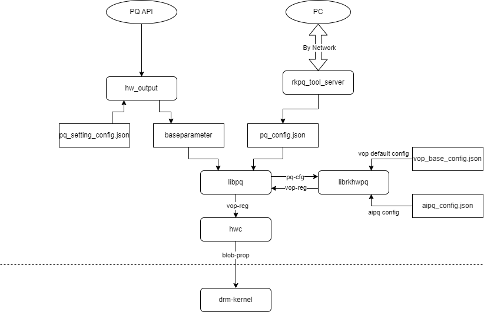

# Rockchip drm_pq_probe 工具使用指南

发布版本：V1.1.6

日期：2025-02-24

文件密级：□绝密   □秘密   □内部资料   ■公开

**免责声明**

本文档按“现状”提供，瑞芯微电子股份有限公司（“本公司”，下同）不对本文档的任何陈述、信息和内容的准确性、可靠性、完整性、适销性、特定目的性和非侵权性提供任何明示或暗示的声明或保证。本文档仅作为使用指导的参考。

由于产品版本升级或其他原因，本文档将可能在未经任何通知的情况下，不定期进行更新或修改。

**商标声明**

“Rockchip”、“瑞芯微”、“瑞芯”均为本公司的注册商标，归本公司所有。

本文档可能提及的其他所有注册商标或商标，由其各自拥有者所有。

**版权所有 © 2025 瑞芯微电子股份有限公司**

超越合理使用范畴，非经本公司书面许可，任何单位和个人不得擅自摘抄、复制本文档内容的部分或全部，并不得以任何形式传播。

瑞芯微电子股份有限公司

Rockchip Electronics Co., Ltd.

地址：     福建省福州市铜盘路软件园A区18号

网址：     [www.rock-chips.com](http://www.rock-chips.com)

客户服务电话： +86-4007-700-590

客户服务传真： +86-591-83951833

客户服务邮箱： [fae@rock-chips.com](mailto:fae@rock-chips.com)

---

**前言**

**概述**

本文主要介绍 Rockchip drm_pq_probe 工具的使用方法, drm_pq_probe 通过调用 libdrm 接口，获取用户态向内核下发的 hwpq 相关的 blob 属性, 解析后将其打印到控制台。同时支持一些常用 debug 信息的获取，方便从目标环境中获取需要的调试信息。

**产品版本**

| **芯片名称** | **内核版本**     |
| ------------ | ---------------- |
| RK3576       | Linux kernel 6.1 及以上内核 |

**读者对象**

本文档（本指南）主要适用于以下工程师：

PQ 调试工程师

**修订记录**

| **版本号** | **作者** | **修改日期** | **修改说明** |
| ---------- | -------- | ------------ | ------------ |
| V1.0.0     | 王锦耀   | 2024-09-14   | 初始版本     |
| V1.1.6     | 王锦耀   | 2025-2-24   | 支持获取更多 debug 信息     |

---

**目录**

[TOC]

---

## 使用说明

将 drm_pq_probe push 到 /vendor/bin 目录下执行即可，需要注意的是 drm_pq_probe 需要运行在 root 权限下：

> adb root
> adb remount
> adb push drm_pq_probe /vendor/bin/drm_pq_probe
> adb shell -t "drm_pq_probe -h"

此时可以看到如下打印信息：

```
Usage: drm_pq_probe [options]
drm_pq_probe version: DrmPqProbe_v1.1.6
Options:
  -h,        show this help message and exit
  -m,        set curve mode, 0: print info, 1: show curve
  -s,        single run mode, print curve once and exit
  -b,        dump baseparameter info
  -c,        continuous run mode
  -d,        dump all pq-related info:
        1: get_all_info get all pq-related info
        2: get_drm_summary      get drm summary info
        5: get_pq_props get pq props info
        4: get_drm_regs get drm regs info
        3: get_drm_state        get drm state info
        6: get_pq_config        get pq_config.json in /data/vendor/rkalgo/
        7: get_aipq_config_in_data      get aipq_config.json in /data/vendor/rkalgo/
        8: get_aipq_config_in_vendor    get aipq_config.json in /vendor/etc/
        9: get_pq_setting_config_in_vendor      get pq_setting_config.json in /vendor/etc/
        10: get_aipq_models     get aipq models in /vendor/etc/
        11: get_hwpq_version    get librkhwpq.so version info
        12: get_hwpq_version    get librkswpq.so version info
        13: get_vop_base_config get vop_base_config.json in /vendor/etc/
  -i,        set info type:
        0: all info             print all info
        1: dci_common           print dci common info
        2: dci_global           print dci global curve
        3: dci_local            print dci local curve
        4: dci_local_ratio      print dci local curve
        5: hdr_common           print hdr common info
        6: hdr_tone_curve       print hdr tone curve
        7: acm_common           print acm common info
        8: acm_y_delta          print acm y delta curve
        9: acm_h_delta          print acm h delta curve
        10: acm_s_delta         print acm s delta curve
        11: acm_y_gain          print acm y gain info
        12: acm_h_gain          print acm h gain info
        13: acm_s_gain          print acm s gain info
        14: shp_common          print shp common info
        15: csc_common          print csc common info
        16: gamma_data          print vop-gamma data
        17: 3dlut_data          print vop-3dlut data
        18: dimming_data        print local-dimming spi data
        19: drm_brightness      print brightness info configed by drm
        20: drm_contrast        print contrast info configed by drm
        21: drm_saturation      print saturation info configed by drm
        22: drm_hue             print hue info configed by drm
```

此时可以根据打印出的 help 信息继续输入操作命令，命令的详细说明如下：
- h: 打印 help 信息
- m: 设置曲线显示模式, 0 表示以打印数值的方式显示，1 表示以曲线图的方式显示，只有 dci_global, acm_y_delta, acm_h_delta, acm_s_delta 支持曲线显示，其他模式只会打印数值。
- x: 曲线显示模式，验 Y 轴方向拉伸的比例。
- r: 刷新当前打印信息。
- b: 打印 baseparameter 信息。
- c: 持续运行模式，持续打印 hwpq 相关信息。
- q: 退出 drm_pq_probe。
- i: 打印的 hwpq 信息类型:

<a id="hwpq_info_type"></a>
| 输入数值 | 输出信息 |
| :---: | :--- |
0 | all info
1 | dci_common
2 | dci_global
3 | dci_local
4 | dci_local_ratio
5 | hdr_common
6 | hdr_tone_curve
7 | acm_common
8 | acm_y_delta
9 | acm_h_delta
10 | acm_s_delta
11 | acm_y_gain
12 | acm_h_gain
13 | acm_s_gain
14 | shp_common
15 | csc_common
16 | gamma_data
17 | 3dlut_data
18 | dimming_data
19 | drm_brightness
20 | drm_contrast
21 | drm_saturation
22 | drm_hue

- d: dump 一些常用的 debug 命令的结果:

| 输入数值 | 输出信息 |
| :---: | :--- |
1 | dump all info
2 | dump cmd "cat /d/dri/0/summary" result in drm_pq_probe
3 | dump cmd "cat /d/dri/0/state" result in drm_pq_probe
4 | dump cmd "cat /d/dri/0/regs" result in drm_pq_probe
5 | dump all props which has "pq" in name
6 | get pq_config.json in /data/vendor/rkalgo/
7 | get aipq_config.json in /data/vendor/rkalgo/
8 | get aipq_config.json in /vendor/etc/
9 | get pq_setting_config.json in /vendor/etc/
10 | get aipq models in /vendor/etc/
11 | get librkhwpq.so version info
12 | get librkswpq.so version info
13 | get vop_base_config.json in /vendor/etc/


也可以在启动 drm_pq_probe 时指定配置参数，参考命令如下:

> adb shell -t "drm_pq_probe -m 0 -i 15"

打印输出信息如下: 

```
set curve mode: 0
set info type: 15
Load /vendor/lib64/libdrm.so successed.
drm probe init success
ws_col=179, ws_row=52
curr_prop_info.cmd = 1280, csc_common      , print csc common info
has_valid_prop = 1
GET_CSC_COMMON
csc_en: 1
brightness: 256
contrast: 256
saturation: 256
hue: 256
r_gain: 256
g_gain: 256
b_gain: 256
r_offset: 256
g_offset: 256
b_offset: 256
```

启动时指定的参数**仅支持 -h, -m, -i, -s, -d, -b, -c 这几个参数**，其中 -m, -i, -h, -d, -b, -c 参数含义上述已说明，-s 表示只运行一次的模式，当指定 -s 时，drm_pq_probe 进行一次打印后会自动退出, 不会再继续等待新的命令输入。

## 使用实例

### 打印不同模块common信息

在命令行输入以下命令：

   > adb shell -t "drm_pq_probe -i 15"

打印信息输出如下，显示的是当前 csc 模块的状态信息：

```
set curve mode: 0
set info type: 15
Load /vendor/lib64/libdrm.so successed.
drm probe init success
ws_col=179, ws_row=52
curr_prop_info.cmd = 1280, csc_common      , print csc common info
has_valid_prop = 1
GET_CSC_COMMON
csc_en: 1
brightness: 256
contrast: 256
saturation: 256
hue: 256
r_gain: 256
g_gain: 256
b_gain: 256
r_offset: 256
g_offset: 256
b_offset: 256
```

在命令行中再输入 `i 14`，打印信息如下，显示的是当前 sharp 模块的状态信息：

```
i 14
input_str = i 14

set info type: 14
curr_prop_info.cmd = 1024, shp_common      , print shp common info
has_valid_prop = 1
GET_SHP_COMMON
shp_en: 0x000005d9
peaking_gain: 96
```

在命令行输入 `q` 退出程序。

```
set info type: 14
curr_prop_info.cmd = 1024, shp_common      , print shp common info
has_valid_prop = 1
GET_SHP_COMMON
shp_en: 0x000005d9
peaking_gain: 96
q
input_str = q
```

### 单次运行dump全部信息并保存到文件中

在命令行输入以下命令：

   > adb shell "drm_pq_probe -s -m 0 -i 0 -d 1 -b > /data/pq_info.txt"
   > adb pull /data/pq_info.txt ./

此时 drm_pq_probe 会打印全部信息并保存到文件中，并将文件从板子上拉取到本地。需要注意的是，使用上述命令获取信息时，可能会存在一些文件不存在等报错信息，这些报错**不影响**信息的获取，并且“文件不存在”的这个现象也是可以用来分析的信息来源。

## Probe 信息说明

drm_pq_probe 工具获取的信息需要结合当前平台 pq 配置生效方式进行分析，后续先介绍 HWPQ 与 SWPQ 配置传递通路，再介绍 drm_pq_probe 工具获取的常用信息的说明。

### HWPQ 配置传递通路

在 RK3576 平台上，HWPQ 相关的配置生成主要在 libpq 与 librkhwpq 中实现，libpq 从获取来自用户的 pq 配置提供给 librkhwpq，再由 librkhwpq 将用户配置转换为寄存器配置并返回 libpq，最终由 hwc 通过 drm 驱动开放的 blob 属性下发给内核，由内核将 pq 相关的寄存器配置配给 vop 硬件来生效。
HWPQ 的参数传递过程如下图所示：



各个模块的功能如下：

- libpq 负责从 baseparameter 或者 pq_config.json 中获取 pq 相关的配置，并将其传递给 librkhwpq。pq_config.json 中的配置主要是使用 PC 端的 RKPQTool 调试时生效。baseparameter 中存储的是非调试状态时生效的 pq 配置。在 libpq 内部，pq_config.json 的优先级会高于 baseparameter 中的配置，当 pq_config.json 存在时，libpq 不会从baseparameter 中获取配置。pq_config.json 会在开机启动时被 hw_output 删除，并在启动 rkpq_tool_server 时自动生成，此时生成的 pq_config.json 的数据是当前 baseparameter 分区中存储的 pq 配置。

- librkhwpq 负责将 pq 用户配置转为寄存器配置，并将其返回给 libpq。由于完整的寄存器数量非常多，且会相互影响，因此 libpq 传递来的配置是经过选择，比较常用且效果直观的部分配置，另外的完整配置会保存在 /vendor/etc/vop_base_config.json 中，用户若需要调整，可以修改该文件，并通过 ```setprop vendor.tvinput.rkpq.vop_base_cfg_update_flag 1``` 更新，测试通过后可以自行将 sdk 中 hardware/rockchip/libvision/config/rk3576/vop_base_config.json 覆盖。
aipq_config.json 主要是保存利用 RKPQTool 调试 aipq 时生成的数据，会保存不同场景调试出来的 acm/dci 配置，存放在板上 /vendor/etc/aipq_config.json 下。用户可以若需要更新默认的 aipq_config.json，可以用 RKPQTool 调试后，将板上的 aipq_config.json 拉出，并将 sdk 中 hardware/rockchip/libvision/config/rk3576/aipq_config.json 覆盖。

- baseparameter 分区中存储的配置可以通过 hw_output 中开放的接口来调整，若用户有多组配置切换的功能，需要将 RKPQTool 输出的配置信息保存至 pq_setting_config.json, 并通过 hw_output 提供的接口切换生效的配置。

- hw_output 负责提供一些 pq 相关的接口给外部，根据从接口获取的配置，更新 baseparameter 分区中的配置，并通知 libpq 重新加载配置。pq_setting_config.json 中包含用户保存的多组 pq 配置，可以利用 hw_output 提供的接口切换生效的配置。

- hwc 在 pq 参数传递通路中，主要负责将从 libpq/librkhwpq 获取的寄存器配置填到 drm-kernel 开放的 blob 属性中，下发给内核生效，从 blob 属性解析出的信息是用户态部分处理的输出，可以根据该结点的信息判断问题是处于内核还是处于用户态。

### drm_pq_probe 常用信息说明

drm_pq_probe 工具可以获取大量当前板上 pq 相关信息，一般出现异常状态时，可以在**正常状态**与**异常状态**下，分别获取一组 drm_pq_probe 输出，并对比两组输出，分析出不同之处。下面为 drm_pq_probe 输出的常用信息说明，可以根据实际情况定位问题。

#### Pq 相关 blob 属性

通过 drm_pq_probe -i X 命令获取的信息，X 可以参考[上文](#hwpq_info_type)介绍填入期望获取的信息的序号。
这部分信息是通过 libdrm 接口获取的**用户态下发给内核**的 blob 属性。
若这部分信息不符合预期，如全部为空，调整没有变化等，则需要进一步查**用户态**相关模块的问题，建议进一步分析 drm_pq_probe 获取的 pq 相关配置信息，版本信息以及 baseparameter 信息。看为何用户态下发给内核的寄存器配置不符合预期，必要情况可以开启以下 log 开关，抓取 logcat 日志分析:

```
adb shell setprop vendor.tvinput.rkpq.log 1
adb shell setprop persist.vendor.rkpq.hwpq_loglevel 5
adb shell setprop vendor.rkpq.hwpq_utils.log_level 5
```

#### drm 打印信息

这部分包含 drm_pq_probe -d X 命令获取的部分信息，主要是 drm 驱动开放的一些 debug 命令的输出，包含以下几条命令：

- ```cat /d/dri/0/summary```
该命令可以 dump 当前的显示状态，包含当前显示的基本状态，可以参考《Rockchip_Developer_Guide_DRM_Display_Driver_CN》分析其中各个参数的含义，初步分析当前显示的状态。
- ```cat /d/dri/0/regs```
该命令可以 dump 当前 vop 硬件的寄存器状态，这部分信息可以用于确认当前 vop 硬件实际生效的状态，可以与 drm_pq_probe 获取的 blob 属性信息对比，确认是否内核有将用户态下发的寄存器配置正确配置给硬件。由于寄存器数量多且可读性差，这部分可以寻求 Rk 相关人员支持，常用的寄存器与 drm blob 属性的对应关系见[附录1](#appendix_1)。

#### pq 相关版本信息

这部分包含 drm_pq_probe -d X 命令获取的部分信息，包含 pq 相关功能的版本信息以及库的校验值，一般在测试阶段用于确认 pq 相关库文件与模型文件是否符合预期。

#### pq 相关配置信息

这部分包含 drm_pq_probe -d X 命令获取的部分信息，包含 pq 相关功能的配置文件，包含安卓属性中的信息，以及各种配置文件的内容。

- ``` getprop | grep pq ```

该命令可以过来当前系统中所有 pq 相关安卓属性，主要获取一些配置信息与工作模式。
需要重点关注的属性为 ```persist.vendor.tvinput.rkpq.mode```，该属性表示当前 pq 的工作模式，具体取值如下：

| 值 | 含义 |
| :---: | :--- |
| 0 | 关闭 PQ |
| 1 | 开启 UI 模式 PQ，hwc 此时会将所有图层合成为一个 argb 图层送 vop |
| 2 | 开启 HDMI 模式 PQ，仅当显示 HDMI 输入信号时生效 |
| 3 | 开启 视频模式 PQ，仅播放视频时生效 |

- ```cat /vendor/etc/vop_base_config.json```

该命令可以获取当前板上 vop 中 pq 相关模块的默认配置，主要是效果不符合预期时，可以通过该命令获取到当前板上的配置文件是否是默认配置，以及与默认配置修改的内容是否合理。

- ```cat /vendor/etc/aipq_config.json```
- ```cat /data/vendor/rkalgo/aipq_config.json```

以上两条命令都是获取的当前板上的 aipq 配置信息，/data/vendor/rkalgo/ 下的配置文件主要是调试过程中生效，若 /data/vendor/rkalgo/ 下的 aipq_config.json 存在，说明当前是调试状态，算法库**不会**使用 /vendor/etc/ 下的 aipq_config.json。但由于 /data/vendor/rkalgo/ 下的配置文件开机时会被删除，因此若需要重启后保存当前的修改，需要手动将用 RKPQTool 修改后的 /data/vendor/rkalgo/aipq_config.json 复制到 /vendor/etc/aipq_config.json。

- ```cat /data/vendor/rkalgo/pq_config.json```

该命令可以获取当前板上走非 aipq 时的 pq 相关配置，该文件也是调试过程中生效，若该文件不存在，则说明当前是非调试状态，会从 baseparameter 中获取配置。
该文件会在开机后运行 rkpq_tool_server 时生成，会将当前 baseparameter 中存储的 pq 配置转换为 pq_config.json，并保存到 /data/vendor/rkalgo/ 下。

- ```cat /vendor/etc/pq_setting_config.json```

该命令可以获取当前板上保存的多组 pq 配置，确认当前板上存储的 pq 配置是否是期望的配置。

#### baseparameter 信息

这部分包含 drm_pq_probe -b 获取的信息，会将 baseparameter 分区中的内容全部打印出来，可以参考 《Rockchip_Developer_Guide_Baseparameter_Format_Define_And_Use_CN.md》 进一步分析其中的内容。

## 常见问题分析

### 1. 灰阶显示异常

灰阶显示异常，包括灰阶并阶，黑场不够黑，白场不够白等问题，需要优先考虑当前显示通路的 range 的处理是否是符合预期的，确认 range 符合预期后，再去分析是否是 dci/csc 等主观调试模块导致的灰阶问题。
range 错误导致的问题主要是以下几种现象：

- 灰阶图两端并阶，通路中存在将 full range 当成 limit range 处理的操作。 
- 黑场不够黑，白场不够白，通路中存在将 limit range 当成 full range 处理的操作。

安卓平台可以参考[附录2](#appendix_2)中的命令想办法将送显的 buffer 都 dump 下来，确认 buffer 中的图像是否已经存在灰阶问题，或者与 ```cat /d/dri/0/summary``` 输出的显示状态是否一致，常见分析方法如下：
- 若 buffer 中存在灰阶问题，则需要找前级模块分析。
- 若 buffer 中不存在灰阶问题，但与 vop 图层信息不一致，则需要看为何配置给 vop 图层的 range 信息与实际的 range 信息不一致，需要 hwc 协助分析，看是否是前级模块传递的信息缺失导致。
- 若 buffer 中不存在灰阶问题，且 vop 图层配置的信息正确，但还是存在灰阶问题，则需要重点看一下 ```cat /d/dri/0/regs``` 输出的 vop 寄存器信息，这部分目前可读性较差，联系 RK 相关人员支持。

### 2. PQ 不生效

一般通过 ```setprop persist.vendor.tvinput.rkpq.mode 0``` 属性来关闭 pq，与 pq 开启时对比是否存在 pq 效果，若出现没有效果的情况，一般尝试从以下几个方面排查：

- 切换 mode 属性是否生效，通过 ```getprop | grep pq``` 命令查看当前的 mode 属性是否生效，可以通过 ```setenforce 0``` 临时关闭 selinux 再尝试。
- 从 drm_pq_probe 抓的信息中，或者直接通过 ```ls /vendor/lib64/ | grep librkhwpq``` 查看是否存在 hwpq 库，若不存在，则需要在 sdk 中的 BoardConfig.mk 中开启 HWPQ 功能再重新编固件。
- 从 drm_pq_probe 抓的信息中，看 acm/dci/shp/csc 相关的 blob 属性是否有下发(如 dci_common, acm_common, shp_common, csc_common)，若不存在这几个属性的信息，则说明 hwpq 库的调用存在问题，找 hwc/libpq/librkhwpq 相关人员排查。
- 若 drm_pq_probe 抓的信息中包含 hwpq 相关的 blob 属性信息，可以进一步分析下属性的内容，重点关注以下几点：
   - 各个模块的开关是否开启，
   - 各个模块的配置是否符合预期，重点关注 DCI_global_lut 中的曲线是否是一条不等于 y=x 的曲线， ACM 的 delta 表是否全为0，sharp 的 peaking_gain 是否为 0。
  
   若下发的属性中就存在问题，则说明传递给 libpq 的配置存在问题，需要去分析 pq 配置的传递通路。
若下发的属性符合预期，再结合[附录1](#appendix_1)中 vop 寄存器与 drm blob 属性的对应关系，看 vop 寄存器中打印出的信息是否与下发的属性一致，若出现不一致，则找内核相关人员处理。
- 在上一条 case 的基础上，若需要分析 pq 配置的传递通路，主要可以关注以下几点：
   - 是否存在 /data/vendor/rkalgo/pq_config.json 文件，若存在，则说明当前是 pq_tools 调试状态，在 pq_tools 生效通路上再查一下 pq 配置生效的问题。若不存在，则说明当前配置是从 baseparameter 中获取的，进一步看 drm_pq_probe 抓到的信息中 baseparameter 部分的 pq 配置是否符合预期。
   - 若 pq_config.json 或者 baseparameter 中的 pq 配置不符合预期，则需要去再找前置模块，如 rkpq_tool_server 或者 hw_output 进行分析。若符合预期，则问题出现在 pq 配置的传递上，可以关闭 selinux 后再尝试。

## 注意事项

- drm_pq_probe 仅支持在 root 权限下运行，仅支持 userdebug 版本的系统。

## 附录

<a id="appendix_1"></a>
### 1. vop 寄存器与 drm_pq_probe 获取信息常用对应关系，部分信息从 reg 中无法获取。

下表为
| vop 寄存器位置 | drm_pq_probe 获取信息 | 说明 |
| :---: | :--- | :--- |
| 0x26d01118 | dci_common | dci_en 对应寄存器的第0bit |
| 0x26d06400 | acm_common | acm_en 对应寄存器的第0bit |
| 0x26d06404 | acm_common | y h s gain 分别对应寄存器的 0-9, 10-19, 20-29 bit |
| 0x27d06ad8-0x27d06bd8 | acm_y_delta, acm_h_delta, acm_s_delta | y h s gain 分别对应寄存器的 0-9, 10-19, 20-29 bit |
| 0x26d06c00 | shp_common | shp_en 对应此寄存器的数值，当数值为 0x1 时为模块关闭，其他 bit 有值时模块开启，详细模块的开关信息看 probe 解析出的内容 |
| 0x27d06d90 | shp_common | 0-10bit 对应 peaking_gain 的数值 |
| 0x27d0cd0-0x27d00cec | csc_common, drm_brightness, drm_contrast, drm_saturation, drm_hue | 包含 csc 相关的配置信息，具体参考 RK3576 TRM |


<a id="appendix_2"></a>
### 2. 常用 debug 命令

| debug 命令 | 说明 |
| :--- | :--- |
| ```setprop vendor.hwc.log debug``` | 开启 hwc log |
| ```setprop vendor.tvinput.rkpq.log 1``` | 开启 libpq log |
| ```setprop persist.vendor.rkpq.hwpq_loglevel 5``` | 开启 rkhwpq log |
| ```setprop vendor.rkpq.hwpq_utils.log_level 5``` | 开启 hwpq_utils log |
| ```setprop vdpp2_debug 0x7``` | 开启 vdpp 部分 log |
| ```setprop vendor.vdpp.debug_cfg 0x7``` | 开启 vdpp 部分 log |
| ```echo 0xffffffff > /sys/module/rk_vcodec/parameters/mpp_dev_debug``` | 开启 mpp 内核打印 |
| ```cat /d/dri/0/summary``` | 获取基本显示状态信息 |
| ```cat /d/dri/0/regs``` | 获取 vop 寄存器状态 |
| ```setprop vendor.tvinput.rkpq.dump.out 1``` | dump libpq 输出 buffer |
| ```setprop vendor.dump true``` | hwc 提供的 dump 显示合成相关 buffer 的属性，开启后会卡顿，允许一会儿后设置为 false，关闭 dump |
| ```setprop vendor.rkpq.hwpq_dump_dst 1``` | dump hwpq 输出寄存器 |
| ```setprop persist.vendor.tvinput.rkpq.mode 0``` | 切换 pq 模式，0为关闭，1 为 UI 模式，所以图层 GPU 合成后过 hwpq，2 为 hdmi 模式，只对 hdmi 输入做处理，3 为视频模式，只对视频流处理|
